<p align="center">
  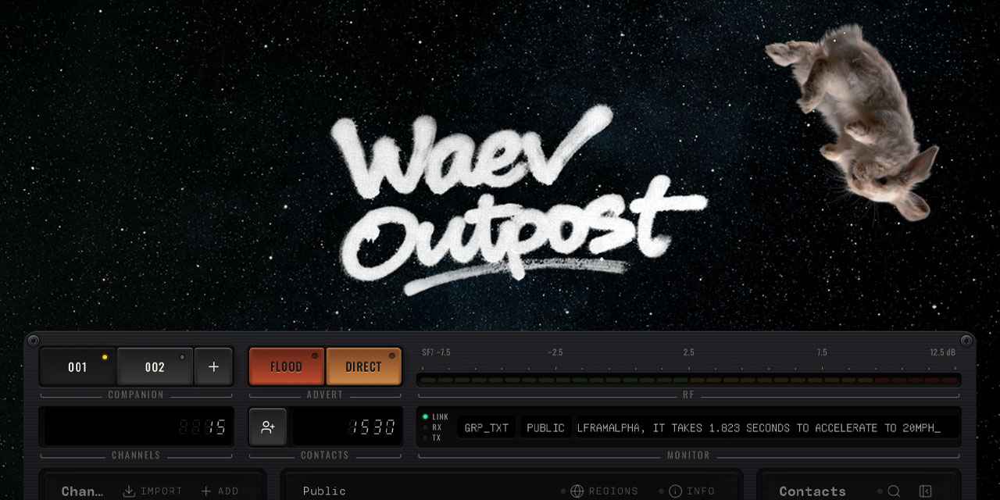
</p>

<h1 align="center">waev:outpost</h1>

<p align="center">
  <strong>A retro-futuristic operations console for <a href="https://meshcore.io/">MeshCore</a> LoRa mesh repeaters.</strong><br>
  Every page is an instrument, not a form.
</p>

<p align="center">
  <a href="https://github.com/Treehouse-00/waev-outpost-plugin/releases"></a>
  <a href="https://github.com/openhop-dev/openhop_repeater"></a>
  <a href="https://meshcore.io/"></a>
  <a href="LICENSE"></a>
</p>

<p align="center">
  <a href="#highlights">Highlights</a> ·
  <a href="#quick-start">Quick start</a> ·
  <a href="#tour">Tour</a> ·
  <a href="#install">Install</a> ·
  <a href="#repeater-compatibility">Compatibility</a> ·
  <a href="#troubleshooting">Troubleshooting</a> ·
  <a href="#development">Development</a>
</p>

waev:outpost turns the live API and packet stream of an [openHop Repeater](https://github.com/openhop-dev/openhop_repeater) into one browser workspace: a map of the mesh that can trace a path, a packet lab, RF and noise-floor analytics, host telemetry, and a companion chat. The repeater installs it as a plugin and serves it itself. Nothing else to run, nothing to patch.

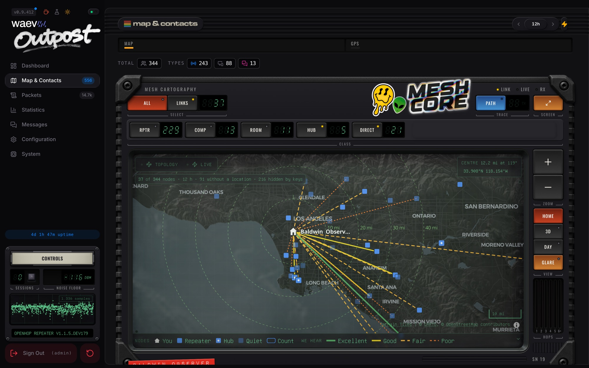

> [!NOTE]
> waev:outpost was pyMC Console and then openHop Console. New versions ship as the **waev:outpost Repeater plugin**; **v0.9.394** was the final legacy standalone release from `pymc_console-dist`. Standalone installs [migrate in four steps](#migrate-from-the-standalone-install) without touching the radio or the credentials.

## Highlights

<table>
  <tr>
    <td width="50%" valign="top"><b>Built as hardware</b><br>Keycaps, seven-segment dies, LED meters and screen wells, all cut from one parts kit. Dark and light, desktop and phone.</td>
    <td width="50%" valign="top"><b>Mesh cartography</b><br>3D terrain, nodes by class and shape, range rings around your repeater, and link lines graded by how well each neighbour is heard.</td>
  </tr>
  <tr>
    <td valign="top"><b>Path Trace</b><br>Send a trace to a node and see the route it takes, out and back, with both directions' readings on every leg.</td>
    <td valign="top"><b>Companion chat</b><br>Message the mesh from the repeater itself: channels and direct messages that read like a chat, with replies, mentions and a NEW line where you left off.</td>
  </tr>
  <tr>
    <td valign="top"><b>Packet lab</b><br>Stacking filters, forwarded-versus-dropped throughput by type, and a byte-level Wire Inspector that walks every copy of a flood.</td>
    <td valign="top"><b>Path disambiguation</b><br>A Viterbi model resolves colliding two-character path prefixes to real nodes, with a confidence for every hop.</td>
  </tr>
  <tr>
    <td valign="top"><b>RF health</b><br>A week of noise floor as a density scatter, tunable anomaly detection, and receive and transmit airtime per radio.</td>
    <td valign="top"><b>Host telemetry</b><br>Load, storage, heat, network I/O and sensor readings from the machine the repeater runs on, live.</td>
  </tr>
</table>

## Quick start

1. In the **built-in Repeater interface**, open **System → Plugins → Catalogue**.
2. Find **waev:outpost** and press **Install**. Catalogue installation enables it automatically. If the Installed tab shows it as disabled, press **Enable**.
3. Use **Open UI**, or open `http://<repeater-ip>:8000/plugins/waev.outpost/`, and sign in with your existing Repeater credentials.

> [!TIP]
> To serve waev:outpost at `http://<repeater-ip>:8000/`, return to the built-in interface and open **System → Configuration → Access → Web Options → Web Frontend**. Select **waev:outpost**; the choice applies immediately, and the direct plugin address keeps working.

For updates, use **System → Plugins → Catalogue → Refresh**, then **Update** when offered. In waev:outpost, the version badge also offers **What's new → Update** when the repeater reports an available plugin update. Updates wait for your confirmation and become available after catalogue approval.

Already on the standalone console? Start with [Migrate from the standalone install](#migrate-from-the-standalone-install). If your repeater has no Plugins page, [upgrade Repeater first](INSTALL.md#prerequisite).

## Tour

### Mesh cartography and Path Trace


The console is built as hardware. Node classes are keys with their own counters. ALL and LINKS choose what is drawn; HOME, 3D, DAY and GLARE sit on the rail beside the screen; hop distribution is an LED column. Every node is the same size at every zoom, its class shown by shape, and your repeater is the white house. Where ordinary nodes pile up, a count stands in for them. Lines to direct neighbours show how well each one is heard, by colour, weight and dash, all judged by one rule: the margin over the spreading factor's floor.

- **Path Trace.** Select a repeater, room server or sensor and press **PATH**. The trace takes the direct link when the node is heard directly, otherwise the way its latest advert came in. While it listens, PATH's lens blinks and its display counts the transmissions the trace costs; once it is heard back, each leg takes the colour of its weaker direction. One trace is on the air at a time, and a lost answer is never resent. The terminal's `trace` command does the same from the keyboard.
- **Deep analysis.** A Viterbi hidden Markov model picks the most probable path when a two-character prefix matches several nodes, weighing recency, co-occurrence, position, geography and measured edges.
- **Live.** Packets animate along their resolved path as they arrive, and only hops that were heard are drawn.
- Ghost-node discovery for prefixes that never resolve, with RF-constrained location estimates. Wardrive replay, GPS diagnostics and a searchable contact inventory live in the same workspace.

### Companion chat


Create a companion identity on the repeater and the console becomes a messenger: no second radio, you talk to the mesh straight from your openHop node. The screens read like a chat. Each run of messages from one sender starts with a tile of their initials or emoji in their colour, and your own messages sit at the right with their delivery marks. A reply shows the line it quotes, a mention of you is lit, and opening a conversation draws a NEW line above what arrived since you last looked. The plate above carries the companion selector, the Flood and Direct advert keys, the channel and contact tallies, an RF meter that every message heard strikes, and a packet monitor with LINK, RX and TX lamps. A contact can be added by its public key before you have ever heard it.

### Dashboard

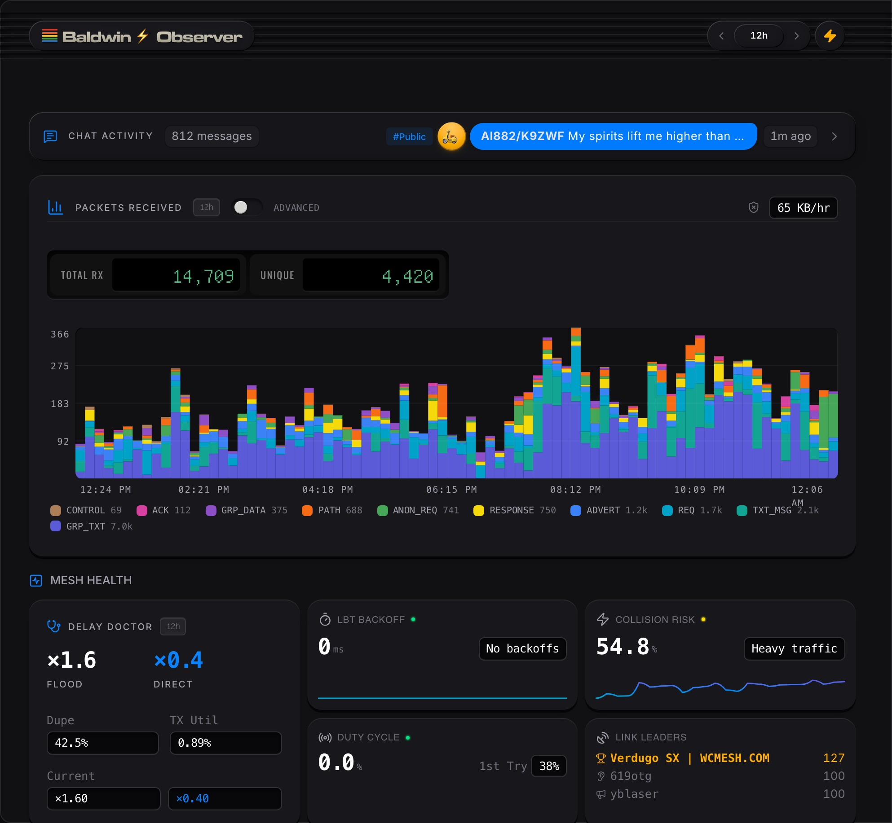

The home dashboard is the one-glance view: chat activity, packets received by type, and the mesh's health, from the delay doctor's flood and direct multipliers to collision risk and the link leaders. Packet history stays in your browser, so a return visit asks the repeater only for what arrived since: on a Raspberry Pi 5, a day of history appears in about 0.2 seconds. The lightning-bolt key beside the time range turns on **Turbo download**, which fetches long windows over two connections at once.

### Packet lab

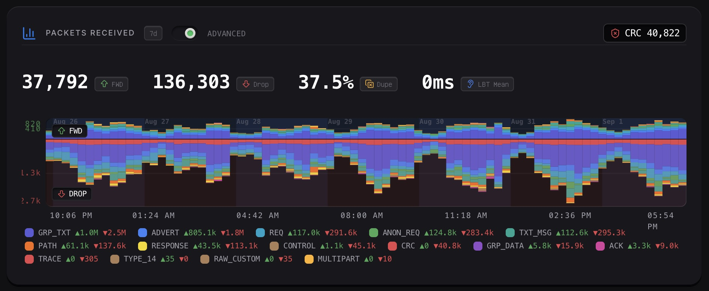

The throughput chart splits traffic into what the repeater forwarded and what it dropped, per packet type, across the selected window. The counters above it are the ones that matter for a repeater: forwarded, dropped, duplicate rate, CRC failures, and mean listen-before-talk wait.

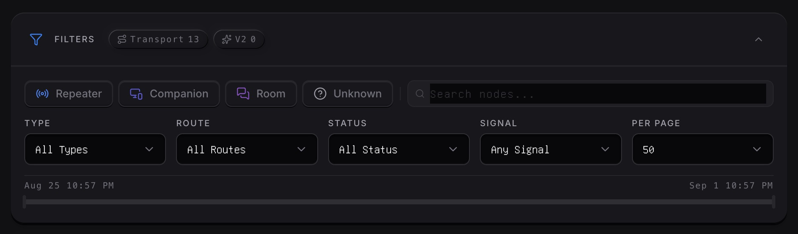

Filters stack. Pick a node class, a route type, a delivery status and a signal band, then narrow to a node by name and scrub the time slider. The same filter engine drives the Packets page and the Statistics analyzer, so a selection means the same thing everywhere.

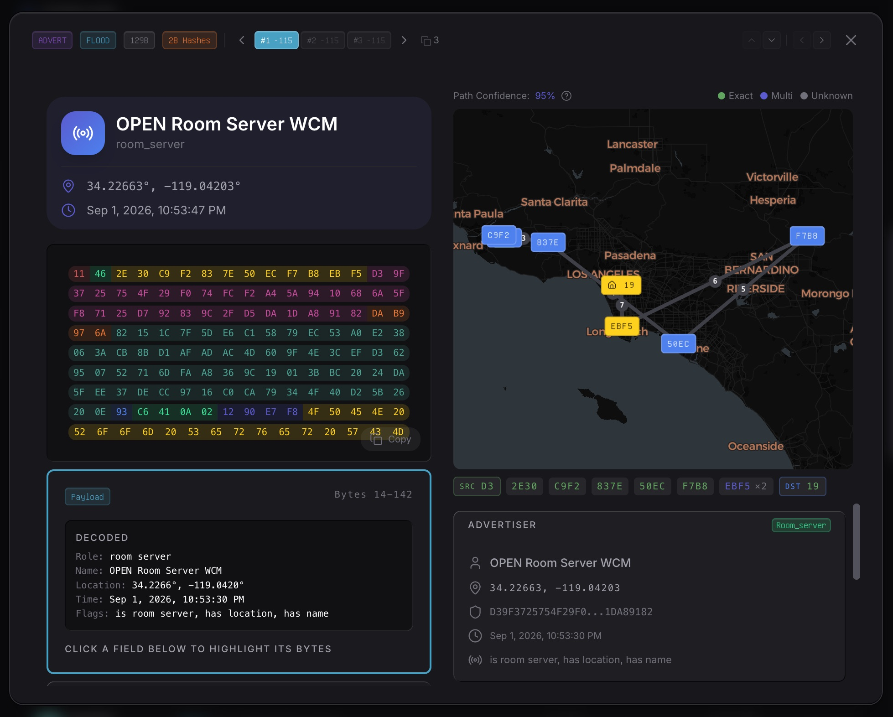

The **Wire Inspector** opens any packet down to its bytes. Header, hashes, path and payload are colour-mapped, and clicking a decoded field highlights the bytes that produced it. The path is resolved and drawn on a map with a confidence score per hop. When a flood arrives more than once, the copies are listed together so you can compare the routes they took.

### RF health

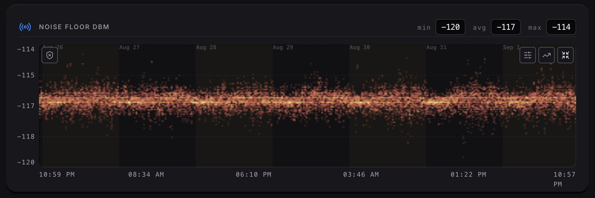

The noise floor is sampled continuously and drawn as a density scatter, so a week of readings shows its shape rather than a smeared average. Daily bands make diurnal patterns obvious.

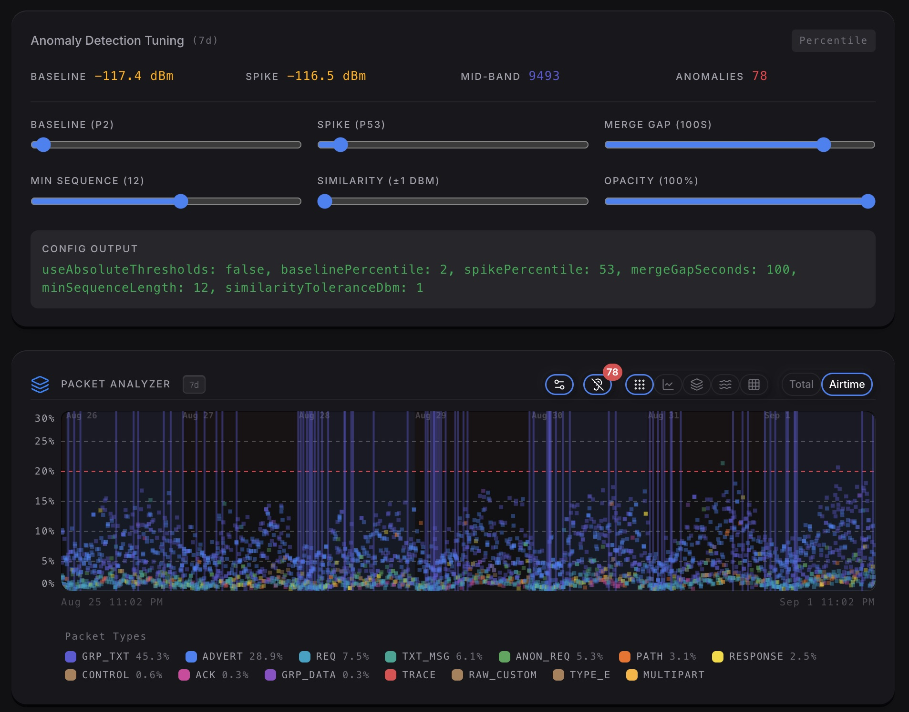

**Anomaly detection** watches the floor for sustained rises above a baseline. Baseline and spike percentiles, merge gap, minimum sequence length and similarity tolerance are sliders, and the resulting configuration is printed so it can be shared. Detected anomalies are counted and overlaid on the packet analyzer, which plots every packet by type across the window, as totals or as airtime. **Airtime → Trend** estimates receive and transmit airtime for all radios or one.

### Channels

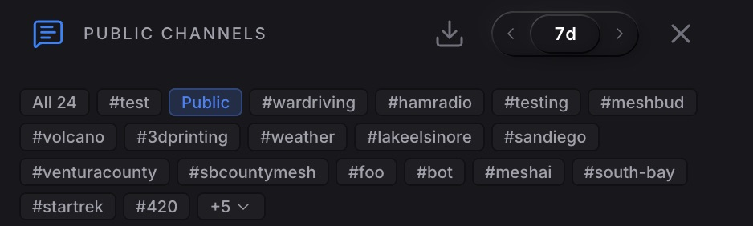

Group text on MeshCore travels under a channel hash. The console recognises the hashes that appear on air, names the ones it knows from its curated geographic and community channel list, and decrypts traffic for any channel whose key it holds.

### Host telemetry

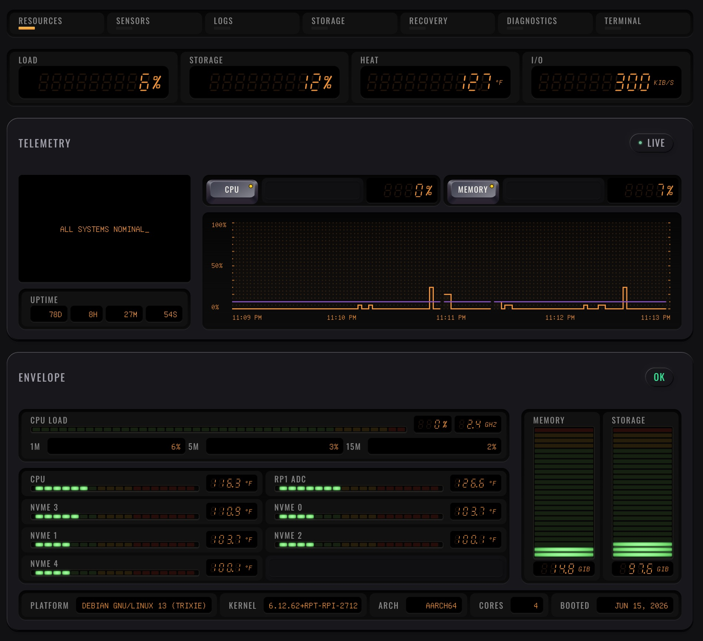

The System workspace reads the host the repeater runs on. Load, storage, heat and network I/O are seven-segment readouts. CPU and memory are a live scope. Temperature envelopes cover the SoC and every NVMe drive, and memory and storage are column meters.

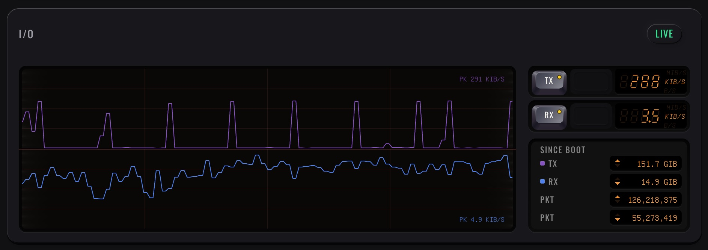

Local network I/O is a two-channel scope for the host's interface, with peak hold, current rates on the readouts, and bytes and packets since boot.

### Around the workspace

- **Link Desk** (Statistics → Links): every neighbour link on one desk, with its samples, duplicates, RSSI and SNR, ordered by when it was heard, its score or its samples, and replayable across the window.
- **Sessions**: who is signed in, and **GRANT**, which puts a node's public key on the repeater's or a room server's access list as read-only, read-write or admin.
- **Terminal**: the repeater in a shell, with `trace`, and `cli <command>` for the repeater's own commands and replies.
- **Configuration**: radio and Radio Fabric, regions, policy, the MQTT observer, companions, sources, plugins, and a sensor manager that writes I2C addresses the way `i2cdetect` prints them.
- **The sidebar**: the CONTROLS drawer for adverts, forwarding, monitor mode and the TX duty limit, the session count and noise-floor screen, and a red key beside Sign Out that restarts the repeater after a configuration check.
- When the radio is not working, a warning runs across the top of every page.

---

## Install

waev:outpost is an application UI plugin managed by openHop Repeater. The plugin is the channel for new releases; the standalone distribution stops at **v0.9.394**.

| Starting point | Next step |
|---|---|
| Built-in Repeater interface with **Plugins** | [Install from the catalogue](#install-from-the-repeaters-plugins-page-recommended). |
| Existing waev:outpost standalone install | [Switch to the built-in interface and migrate](#migrate-from-the-standalone-install). |
| Repeater without a Plugins page, or with an unavailable plugin manager | [Update Repeater and its plugin manager](INSTALL.md#prerequisite). |
| Repeater in Docker or Proxmox LXC | Use the same plugin workflow once the Repeater plugin manager is available. Follow [Repeater's installation guide](https://github.com/openhop-dev/openhop_repeater) for the host or container setup. |

waev:outpost requires a working [openHop Repeater](https://github.com/openhop-dev/openhop_repeater) with application UI plugin support. Repeater owns the radio configuration, identities, credentials, storage and service; installing this UI plugin does not reset any of them. The examples here assume Repeater's default port, 8000.

### Install from the repeater's Plugins page (recommended)

1. In the **built-in Repeater interface**, open **System → Plugins → Catalogue**.
2. Find **waev:outpost** and press **Install**. The repeater downloads the approved wheel and checks its checksum, plugin ID and version against the catalogue.
3. On the **Installed** tab, confirm **UI READY**. Catalogue installs are enabled automatically; if it is disabled, press **Enable**.
4. Use **Open UI** or visit `http://<repeater-ip>:8000/plugins/waev.outpost/`. Sign in with your existing Repeater credentials.
5. To make it the default at `/`, open **System → Configuration → Access → Web Options → Web Frontend** and select **waev:outpost**, the plugin entry. If an older standalone copy is also installed, choose the plugin entry, not **openHop Console** pointing at `/opt/pymc_console/web/html`.

Updates are approved by you, never installed automatically, and keep the same Repeater configuration and credentials. A new GitHub release appears in the catalogue only after its metadata has been approved; **Refresh** cannot install a version that is not approved yet.

### Install a plugin wheel

Use this when you need a release directly or cannot reach the catalogue:

1. Download the single `.whl` asset from a [waev-outpost-plugin release](https://github.com/Treehouse-00/waev-outpost-plugin/releases).
2. In the built-in interface, open **System → Plugins → Install wheel**, choose the file, and press **Install**.
3. Press **Enable** if the plugin is disabled, then open its UI and optionally select it under **Web Options → Web Frontend** as above.

A fresh local-wheel installation has no catalogue repository metadata, so **Update** may be unavailable: update it by uploading a newer wheel with **Install wheel** again. To adopt catalogue-managed updates, reinstall the approved catalogue version through the [authenticated API](INSTALL.md#automation); check the approved version first, because it may be older than a manually uploaded release.

### Migrate from the standalone install

The `pymc_console-dist` distribution and its `manage.sh upgrade` path end at **v0.9.394**. New waev:outpost versions are published as the `waev.outpost` plugin.

1. Keep `/opt/pymc_console/web/html` and your existing Repeater configuration in place. No uninstall, credential reset or radio reconfiguration is needed.
2. In your current waev:outpost, open **Configuration → Web Frontend** and select **Default Frontend**, the built-in Repeater interface. In v0.9.394 this applies immediately and reloads. In newer waev versions, press **Set as default interface**, then **Open default interface in a new tab**. Open your repeater's home address `/` if you are still viewing the direct plugin URL.
3. In the built-in interface, follow **System → Plugins → Catalogue → waev:outpost → Install**. Confirm **UI READY** and open `/plugins/waev.outpost/` to check the installed version and your repeater connection.
4. Make the plugin the default through **System → Configuration → Access → Web Options → Web Frontend**. Choose the **waev:outpost plugin** entry.

Repeater still serves the same API with the same configuration, radio identities and login credentials. Keep the same host, port and protocol to keep that browser origin's saved preferences; your old standalone files can stay as a fallback. To switch back, choose **Default Frontend** again. See [the complete migration and recovery guide](INSTALL.md#migrate-from-the-standalone-install) if the current UI cannot be opened.

<details>
<summary><b>Upgrade, uninstall and automation</b></summary>

**Upgrade.** For a catalogue installation, use **System → Plugins → Catalogue → Refresh**, then **Update**, or **What's new → Update** from the version badge. For a local-wheel installation, [upload the newer wheel](#install-a-plugin-wheel). Standalone users must [migrate to the plugin](#migrate-from-the-standalone-install) for new versions; rerunning the old `manage.sh upgrade` does not migrate the installation. Repeater itself is updated separately, through its supported installer or container upgrade.

**Uninstall.** First choose **Default Frontend** and open the repeater's home address to confirm the built-in interface works. Then use **System → Plugins → Installed → Uninstall** for waev:outpost, leaving **Also delete persistent data directory** unchecked to keep plugin data for a later reinstall. Removing a UI plugin does not uninstall Repeater, and the old `/opt/pymc_console` folder is separate; see [legacy recovery and cleanup](INSTALL.md#legacy-standalone-reference) before removing any old files.

**Automation.** The [installation guide](INSTALL.md#automation) documents authenticated catalogue installation, wheel upload, updates and default-interface selection, all with Repeater's existing API credentials.

</details>

### Following releases

Release notes live in [CHANGELOG.md](CHANGELOG.md), on [waev-outpost-plugin releases](https://github.com/Treehouse-00/waev-outpost-plugin/releases), and in the console's **What's new** dialog. The [final standalone v0.9.394 release](https://github.com/Treehouse-00/pymc_console-dist/releases/tag/v0.9.394) is a legacy fallback, not an update channel. A published release may be newer than the version approved for catalogue installation; Repeater's Plugins page reports the approved update.

| For | Use |
|---|---|
| Feed readers | `https://github.com/Treehouse-00/waev-outpost-plugin/releases.atom` |
| The latest release as JSON (`tag_name`, `body`, assets) | `https://api.github.com/repos/Treehouse-00/waev-outpost-plugin/releases/latest` |
| The full changelog as Markdown | `https://raw.githubusercontent.com/Treehouse-00/waev-outpost-plugin/main/CHANGELOG.md` |

### What each operation touches

| Operation | Effect |
|---|---|
| Install or update the UI plugin | Replaces waev:outpost's managed plugin files; Repeater configuration and credentials remain in place. |
| Select a default frontend | Changes `web.web_path`, deciding which UI Repeater serves at `/`. |
| Uninstall the UI plugin | Removes its release files; plugin data is kept unless you explicitly choose to delete it. |
| Legacy standalone `manage.sh` | Manages the separate `/opt/pymc_console` files. It does not install or update the plugin. |
| Update Repeater | Uses Repeater's own installer or container process, independently of the UI plugin. |

On a native installation, Repeater's service tools remain the way in: `sudo systemctl status openhop-repeater` and `sudo journalctl -u openhop-repeater -f`.

---

## Repeater compatibility

waev:outpost is built against the openHop Repeater `dev` branch. Everything it shows comes from the Repeater's own HTTP API and its two WebSocket streams, `/ws/packets` for the live mesh and `/ws/companion_frame` for the companion page. It applies no patches to the Repeater and needs nothing installed beside it.

Features that need a newer Repeater hide themselves on an older one rather than failing:

| Feature | Needs |
|---|---|
| What each MQTT broker has been sent, the Observer's recorded day, and the Usage module on System → Resources | Repeater `dev` from November 2026 |
| Path Trace: the map's PATH key and the terminal's `trace` | Repeater `dev` from 29 October 2026; release 1.1.4 and older do not offer it |
| GRANT on Sessions | Repeater `dev` from October 2026 |
| Direct adverts and their interval, discovered regions and a node's scopes, the MQTT neighbours schedule, the CAD page's Manual Check, Neighbour Links, the multi-radio selector | A Repeater from mid-2026 or newer |

<details>
<summary><b>Renamed fields the console reads both ways</b></summary>

Where the Repeater renamed something, the console reads both the old and the new name and writes whichever the Repeater it is talking to understands, so an older Repeater keeps working:

- Modem transports: `pymc_tcp` and `pymc_usb` became `modem_tcp` and `modem_usb` in August 2026.
- The modem sensor: `pymc_modem` became `openhop_modem`.
- ACL roles: the Repeater now reports `admin`, `read_write`, `read_only` and `guest` with MeshCore's numbering; older ones report only `admin` and `guest`.
- The stats WebSocket carries the sidebar vitals (uptime, mode, utilisation, noise floor, advert tier) in every beat and the 24-hour packet aggregate one beat in six; the console reads either cadence.
- Noise-floor history is paged: a Repeater from September 2026 answers with up to 300 samples an hour of the window where older ones answered with the newest 1,000 samples, so the console asks for a bounded page on every Repeater.
- Config exports and the stats view redact the modem's TCP token to `*** REDACTED ***`; posting that value back leaves the stored token in place, so a re-imported export or a saved radio form never clears it.
- A multi-radio Repeater lists its radios and names a default; the Configuration page's Radio module and the Radio Hardware page pick which one to edit and write to that radio's entry.

</details>

<details>
<summary><b>Optional back ends, and what is not drawn yet</b></summary>

Two optional back ends are used when present and done without otherwise. The analytics API (`/api/analytics/*`) is not part of the upstream Repeater; without it the console computes topology, disambiguation and sparklines itself. The companion REST API (`/api/v1/companions`) comes from our fork of the Repeater; without it the companion page works over the frame stream alone. The Logs page listens to the Repeater's log stream and falls back to polling when the stream is refused.

Repeater features the console knows about but does not draw yet, kept in its API layer with a note of where each belongs: noise-floor and route statistics, the count of adverts by node class, the Docker-safety flag on serial ports, server-side session verification, the radio a packet arrived on, and the server-sent-event streams for GPS and neighbour discovery where the console still polls.

</details>

---

## Troubleshooting

<details>
<summary><b>waev:outpost does not load, or the Repeater's own UI appears</b></summary>

In the built-in interface, open **System → Plugins → Installed** and confirm waev:outpost is enabled and shows **UI READY**. Test its direct address, `/plugins/waev.outpost/`. If that works, select the plugin under **System → Configuration → Access → Web Options → Web Frontend** to use it at `/`.

If neither interface opens, follow [Recovery](INSTALL.md#recovery). Native hosts can also check `systemctl status openhop-repeater` and `journalctl -u openhop-repeater -n 100`; use your container's service logs for Docker installations.

</details>

<details>
<summary><b><code>manage.sh install</code> says Repeater is not installed</b></summary>

This is the legacy standalone installer, which does not install the plugin. Use Repeater's **System → Plugins** page for current releases. If that page or its manager is unavailable, follow the [plugin prerequisites](INSTALL.md#prerequisite).

</details>

<details>
<summary><b>Login fails, or the UI and the API disagree</b></summary>

Use the same credentials configured for Repeater; migrating the UI does not create a new account. If needed, update Repeater through its own supported installer or container process and update waev:outpost through its plugin channel, then hard-refresh the browser with `Cmd+Shift+R` on macOS or `Ctrl+Shift+R` on Linux and Windows. The version badge in the sidebar shows the build you are running.

</details>

<details>
<summary><b>waev:outpost loads but no packets appear</b></summary>

- Allow a fresh Repeater 30–60 seconds to initialize.
- Confirm radio frequency, GPIO, and SPI/USB transport in Repeater configuration.
- Check the live service log with `journalctl`.
- The connection dot in the sidebar reports the packet WebSocket. If it degrades, the console falls back to polling; if it stays offline, check that nothing between the browser and port 8000 strips WebSocket upgrades.

</details>

<details>
<summary><b>Channels show hashes instead of names</b></summary>

A channel is named when its hash matches the curated list or a channel you have joined. Under **Messages → Manage**, join a hashtag channel by name, or a private channel by pasting its key, and traffic already in the local cache is decrypted for it.

</details>

<details>
<summary><b>The companion page says another client is attached</b></summary>

A companion's Frame link serves one client at a time. Close the other session, or take the link from this one with the red key beside the packet monitor, **Evict the other client and connect**; the other client is told it was displaced. The Companion API mode keeps chat available without the Frame link at all, at the cost of the trusted radio controls.

</details>

<details>
<summary><b>Data looks stale, or the repeater's database has grown large</b></summary>

The console keeps the last seven days of packet history it has loaded in your browser and revalidates it against the repeater on reload. Use the console's history controls to reset stale history deliberately; a reload does not discard saved history. The repeater's own database is managed under **System → Storage**, where tables can be purged and the file vacuumed.

</details>

---

## How it works

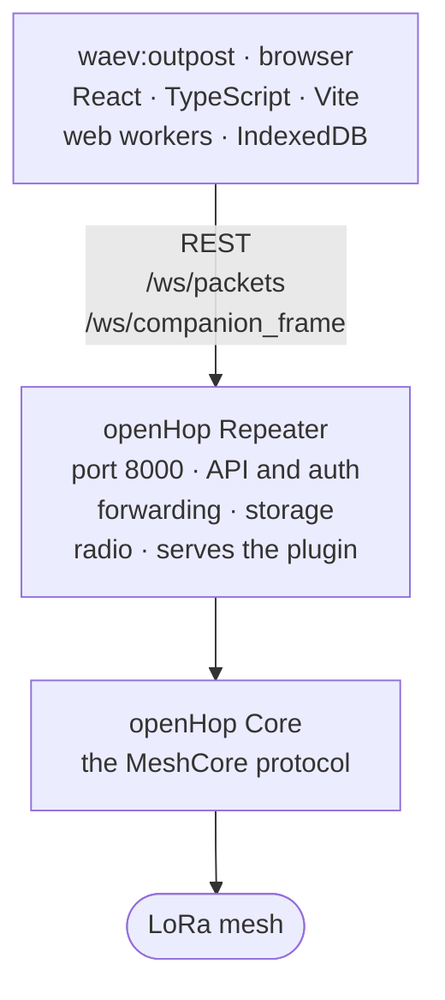

waev:outpost is deployed as static assets in Repeater's managed plugin storage. Repeater serves the single-page app at `/plugins/waev.outpost/` beside its same-origin API, so no second production service or cross-origin configuration is needed. Selecting the plugin as the default sets `web.web_path` to `plugin:waev.outpost`. The old `/opt/pymc_console/web/html/` directory belongs only to legacy standalone installations.

MeshCore paths carry two-character node prefixes, so several nodes may match a hop. waev:outpost uses a Viterbi hidden Markov model to select the most probable path from known candidates plus an unknown-node state. Scoring combines observation recency, prefix co-occurrence, path position, geographic plausibility, and measured edge evidence. The resulting topology powers path confidence, ghost-node discovery, link analysis, and TX-delay recommendations.

The frontend also carries a TypeScript MeshCore protocol implementation for binary frame parsing, packet-type decoding, channel-key derivation and group-text decryption. Heavy work runs in web workers, so the instruments stay responsive on a phone.

---

## Development

The source repository uses React 18, TypeScript, Vite 6, Zustand, MapLibre GL, µPlot and xterm.js. Use the exact Node version in `.node-version` and the npm version in the root `packageManager` field. Supply the licensed Motion registry credential through your environment, or `MOTION_PACKAGE_TARBALL` pointing to an already obtained tarball with the lockfile's exact integrity. Setup keeps credentials and dependency installation in a disposable workspace; tracked manifests stay unchanged.

```bash
npm run setup         # toolchain, dependencies and the browser for checks
npm run verify:fast   # types, lint, tests, distribution and workflow checks
npm run verify        # everything, including both builds and browser checks
```

`verify` does not publish. For a development server, set a proxy target in `frontend/.env.local` and run `npm --prefix frontend run dev`; production builds always use the same-origin Repeater API. `npm run build` writes `frontend/out/`. Private contributors should read `docs/DEVELOPMENT.md` and `AGENTS.md` for prerequisites, ownership and release and recovery procedures; those internal files are not part of the public distribution.

### The plugin wheel

The console ships as a UI-only openHop plugin. From `frontend/`:

```bash
npm run build:plugin
```

That builds the app a second time with the absolute `/plugins/waev.outpost/` base into `frontend/out-plugin/` (a relative base would break nested deep links), stages `plugin-stage/` with `openhop-plugin.json` stamped with the package version, and packs a PEP 427 wheel, `plugin-dist/waev_outpost_plugin-<version>-py3-none-any.whl`. Re-pack after a prior stage with `npm run pack:plugin`. Install a development wheel through **System → Plugins → Install wheel** (or `POST /api/plugins/install`), enable it, then open `/plugins/waev.outpost/`.

Every release publishes the wheel as the single `.whl` asset of its [waev-outpost-plugin](https://github.com/Treehouse-00/waev-outpost-plugin) release, and published releases are kept, because approved catalogue entries and rollbacks use exact versioned release URLs. After publication, a workflow downloads and verifies those release bytes, calculates their SHA-256, and opens a catalogue PR for `waev.outpost`; the catalogue's own certification policy and checks decide its merge. See [release setup](RELEASE.md) for the required repository secrets.

---

## License

MIT. See [LICENSE](LICENSE).

## Credits

- [RightUp](https://github.com/rightup), creator of the original pyMC Repeater and Core projects and a maintainer of the MeshCore Python ecosystem
- [openHop Repeater](https://github.com/openhop-dev/openhop_repeater), the repeater daemon and the backend waev:outpost plugs into
- [openHop Core](https://github.com/openhop-dev/openhop_core), the MeshCore protocol library
- [MeshCore](https://meshcore.io/), the MeshCore project and community
- [d40cht/meshcore-connectivity-analysis](https://github.com/d40cht/meshcore-connectivity-analysis), the Viterbi HMM approach to path disambiguation
- [meshcore-bot](https://github.com/agessaman/meshcore-bot), recency scoring and dual-hop anchor disambiguation

---

<p align="center"><sub>waev:outpost is built as hardware: every page is an instrument, not a form. Bolt it to your repeater and watch the mesh breathe.</sub></p>
